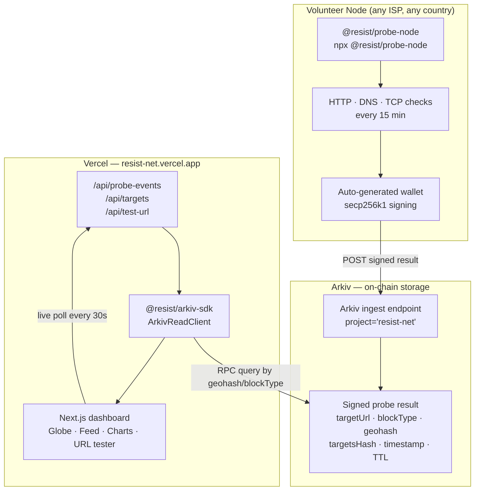

<p align="center">
  
</p>

<p align="center">
  <strong>🌐 <a href="https://resist-net.vercel.app">resist-net.vercel.app</a></strong> &nbsp;·&nbsp;
  <a href="https://resist-net.vercel.app/landing.html">Landing page</a> &nbsp;·&nbsp;
  <a href="https://resist-net.vercel.app/pitch.html">Pitch deck</a>
</p>

<br/>

**Decentralised internet censorship radar. Volunteer nodes probe monitored sites every 15 minutes, sign results on-chain, and surface them on a live dashboard.**

> India has ordered 771 documented internet shutdowns in 7 years — more than any other country on earth. Each one starts with people reloading the page, assuming it's a glitch. ResistNet closes that gap.

---

## What it does

- **Real-time detection** — HTTP, DNS, and TCP probes every 15 minutes from volunteer nodes inside the country, on real ISPs
- **Block type identification** — DNS poisoning, TCP reset, HTTP block, TLS-SNI interference, full unreachability
- **On-chain evidence** — every result cryptographically signed by the node's wallet and written to Arkiv; permanent, tamper-proof, auditable
- **Data sovereignty** — raw traffic never leaves the country; the node is a witness, not a proxy
- **Live dashboard** — 24h availability charts per site, real-time event feed, test any URL in seconds
- **One-command node** — `npx @resist/probe-node` — run from anywhere, earns on-chain reputation

---

## Architecture



---

## The censorship-resistance stack

| Layer | Tool | Status |
|---|---|---|
| Evidence + Awareness | **ResistNet** | ← this project |
| Messaging | BitChat / Briar | Built |
| Routing | Tor / Psiphon | Built |
| Publishing | IPFS / Nostr | Built |

---

## Monorepo layout

| Package | Description |
|---|---|
| `apps/web` | Next.js dashboard — globe, network tab, activity feed, URL tester |
| `packages/probe-node` | Daemon: HTTP/DNS/TCP checks on a 15-min schedule, wallet-signed, writes to Arkiv |
| `packages/arkiv-sdk` | Client library for the Arkiv ingest/query API |
| `packages/shared` | Shared types + target list |
| `packages/map-ui` | Geohash decoding and marker helpers |
| `packages/proxy-client` | Proxy client utilities |

---

## Setup

```sh
npm install
```

Create `apps/web/.env.local`:

```sh
ARKIV_RPC_URL=https://arkiv.resist-net.vercel.app
NEXT_PUBLIC_ARKIV_RPC_URL=https://arkiv.resist-net.vercel.app
```

Start dev:

```sh
npx turbo run dev
# → http://localhost:3000
```

---

## Run a probe node

```sh
ARKIV_URL=https://arkiv.resist-net.vercel.app/ingest npx @resist/probe-node
```

Single tick:

```sh
ARKIV_URL=https://arkiv.resist-net.vercel.app/ingest npx @resist/probe-node --once
```

See [`packages/probe-node/README.md`](packages/probe-node/README.md) for all options.

---

## Build & test

```sh
npx turbo run build   # build all packages
npm test              # Playwright e2e
```

---

## Docs

- [`docs/arkiv-expiry.md`](docs/arkiv-expiry.md) — how Arkiv TTL works and why expired records remain valid as legal evidence

---

## Monitored targets

Twitter · Instagram · YouTube · Wikipedia · Signal

---

## License

MIT
