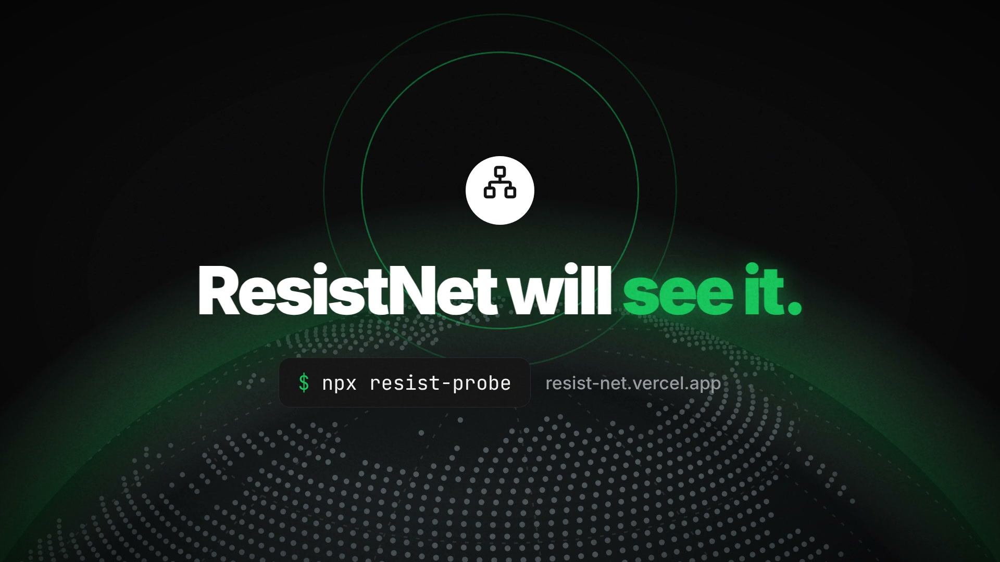
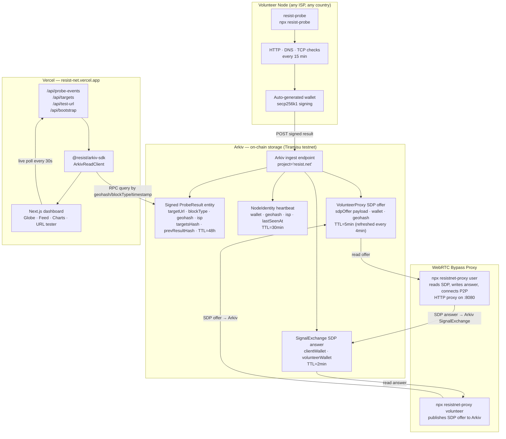

<p align="center">
  
</p>

<p align="center">
  <strong>🌐 <a href="https://resist-net.vercel.app">resist-net.vercel.app</a></strong> &nbsp;·&nbsp;
  <a href="https://resist-net.vercel.app/landing.html">Landing page</a> &nbsp;·&nbsp;
  <a href="https://resist-net.vercel.app/pitch.html">Pitch deck</a>
</p>

<p align="center">
  <a href="docs/arkiv-expiry.md"></a>
</p>

<p align="center">
  <a href="https://github.com/Philotheephilix/resist.net/raw/main/docs/brag.mp4">
    
  </a>
  <br/>
  <sub>▶ <a href="https://github.com/Philotheephilix/resist.net/raw/main/docs/brag.mp4">Watch the 30-second launch video</a></sub>
</p>

<br/>

**Decentralised internet censorship radar. Volunteer nodes probe monitored sites every 15 minutes, sign results on-chain via Arkiv, and surface them on a live dashboard.**

> India has ordered **771** documented internet shutdowns in 7 years — more than any other country on earth. Each one starts with people reloading the page, assuming it's a glitch. ResistNet closes that gap.

---

## What it does

- **Real-time detection** — HTTP, DNS, and TCP probes every 15 minutes from volunteer nodes inside the country, on real ISPs (Jio, Airtel, BSNL)
- **Block type identification** — DNS poisoning, TCP RST injection, HTTP block page, TLS-SNI interference, full unreachability
- **On-chain evidence** — every result cryptographically signed by the node's wallet and written to Arkiv (Tiramisu testnet); permanent, tamper-proof, auditable
- **Hash chain integrity** — each probe result includes `prevResultHash`, creating a tamper-evidence chain per node; the dashboard flags any gap
- **Quorum verification** — a block is marked `verified` only when 5+ distinct geohash regions (≈45km cells) independently report it, guarding against single-node false positives
- **Data sovereignty** — raw traffic never leaves the country; the node is a witness, not a proxy
- **WebRTC bypass proxy** — censored users run `npx resistnet-proxy user`; volunteers publish SDP offers to Arkiv; P2P tunnel established via Arkiv signalling
- **Live dashboard** — 24h availability charts per site, real-time event feed, geoquorum badges, test any URL in seconds
- **One-command node** — `npx resist-probe` — runs from anywhere, earns on-chain reputation

---

## Live node (running now)

| Field | Value |
|---|---|
| Node wallet | `0x9236c57BaeB306d5F4BB9E6E2A5f15B74C1aF305` |
| Geohash | `ttnnm` (India) |
| ISP | Jio |
| NodeIdentity entity | `0x1993591659b2432b996d80abf1f29ff6599bc6ce9d926a82901c52ad17ece7a5` |
| Chain | Arkiv Tiramisu testnet (chain ID 7738577) |
| Probe interval | 15 minutes |
| Monitored targets | twitter.com · instagram.com · youtube.com · wikipedia.org · signal.org |

---

## Architecture



---

## Probe detection methods

| Check | What it detects |
|---|---|
| HTTP `fetch` (10s timeout) | Block pages, 403/451, opaque responses |
| DNS vs baseline resolver (8.8.8.8 / 1.1.1.1 / 9.9.9.9) | DNS poisoning — local resolver returns a different IP |
| TCP connect port 443 (5s timeout) | TCP RST injection, port blocks, transparent proxies |
| Cross-check DNS diff + TCP liveness | Distinguishes CDN anycast from real poisoning |

Block classification (`blockType` field on-chain):

| Value | Meaning |
|---|---|
| `dns_poisoning` | Local resolver returns an IP not served by any public resolver |
| `tcp_rst` | TCP RST received on connect — active injection |
| `http_block` | TCP connects but HTTP returns non-2xx/3xx |
| `full_unreachable` | TCP closed, no DNS, no HTTP |
| `null` | Reachable |

---

## Arkiv entity schema

All entities live under `project="resist.net"` on Tiramisu testnet.

### `proberesult` — TTL 48h
Written once per target per probe cycle. All attribute names are lowercase (Arkiv constraint).

| Attribute | Type | Value |
|---|---|---|
| `entitytype` | str | `"proberesult"` |
| `nodewallet` | str | node's wallet address |
| `targeturl` | str | e.g. `https://twitter.com` (max 128 bytes) |
| `timestamp` | u64 | Unix ms (BigInt — Arkiv i32 too small) |
| `reachable` | bool | true/false |
| `blocktype` | str | block classification or `""` |
| `httpstatus` | i32 | HTTP status code or `-1` |
| `responsetimems` | i32 | ms or `-1` |
| `geohash` | str | 5-char geohash prefix (e.g. `ttnnm`) |
| `isp` | str | ISP name (e.g. `Jio`) |
| `networktype` | str | `wifi`/`mobile`/`unknown` |
| `prevresulthash` | str | SHA-256 of previous result (tamper chain) |
| `targetshash` | str | SHA-256 of canonical target list (anti-tampering) |

Payload (JSON): `{ id, dnsPoisoned, dnsExpected, dnsReceived, tcpConnected, tcpRstInjected, prevResultHash }`

### `nodeidentity` — TTL 30min
Heartbeat published every probe cycle. Used by dashboard to count live nodes.

| Attribute | Type | Value |
|---|---|---|
| `entitytype` | str | `"nodeidentity"` |
| `wallet` | str | node's wallet address |
| `geohash` | str | 5-char prefix |
| `isp` | str | ISP name |
| `networktype` | str | `wifi`/`mobile`/`unknown` |
| `lastseenms` | u64 | Unix ms of last heartbeat |

### `volunteerproxy` — TTL 5min (refreshed every 4min)
Published by proxy volunteer. Payload is the WebRTC SDP offer (JSON).

| Attribute | Type | Value |
|---|---|---|
| `entitytype` | str | `"volunteerproxy"` |
| `wallet` | str | volunteer wallet |
| `geohash` | str | volunteer's geohash |
| `capacityslots` | i32 | available connection slots |
| `createdat` | u64 | Unix ms |

### `signalexchange` — TTL 2min
Written by the censored user after receiving the volunteer's SDP offer. Deleted after ICE connects.

| Attribute | Type | Value |
|---|---|---|
| `entitytype` | str | `"signalexchange"` |
| `volunteerwallet` | str | target volunteer wallet |
| `clientwallet` | str | user wallet |
| `createdat` | u64 | Unix ms |

Payload: WebRTC SDP answer (JSON).

### `probequeue` — TTL up to 7 days
Custom URL probe requests submitted via the dashboard.

| Attribute | Type | Value |
|---|---|---|
| `entitytype` | str | `"probequeue"` |
| `requesterwallet` | str | requester wallet |
| `targeturl` | str | URL to probe |
| `volunteercount` | i32 | how many volunteers to involve |
| `repeatcount` | i32 | number of probe cycles |
| `intervalseconds` | i32 | seconds between cycles |
| `paymentglm` | i32 | GLM millionths (payment / 1000) |
| `createdat` | u64 | Unix ms |
| `expiresat` | u64 | Unix ms expiry |

---

## The censorship-resistance stack

| Layer | Tool | Status |
|---|---|---|
| Evidence + Awareness | **ResistNet** | ← this project |
| Messaging | BitChat / Briar | Built |
| Routing | Tor / Psiphon | Built |
| Publishing | IPFS / Nostr | Built |

> The rest of the stack is built. ResistNet is the missing piece: the early warning system that tells you when and where to reach for those tools.

---

## Monorepo layout

| Package | Description |
|---|---|
| `apps/web` | Next.js dashboard — globe, network tab, activity feed, URL tester |
| `packages/probe-node` | Daemon: HTTP/DNS/TCP checks on a 15-min schedule, wallet-signed, writes to Arkiv |
| `packages/arkiv-sdk` | Client library wrapping `@arkiv-network/sdk` — all entity writes/reads, chain gap detection |
| `packages/proxy-client` | WebRTC bypass proxy — volunteer publishes SDP to Arkiv; censored user reads, answers, connects P2P |
| `packages/proxy-publish` | Published npm binary `resistnet-proxy` — extensionless bin for npm 11 compatibility |
| `packages/shared` | Shared types, target list, targets hash, IP helpers |
| `packages/map-ui` | Geohash decoding and map marker helpers |

---

## Setup

```sh
npm install
```

Create `apps/web/.env.local` (or `.env`):

```sh
ARKIV_RPC_URL=https://rpc.tiramisu.db-chain.testnet.arkiv.network
NEXT_PUBLIC_ARKIV_RPC_URL=https://rpc.tiramisu.db-chain.testnet.arkiv.network
DEV_PRIVATE_KEY=0x...   # only needed for probe-node / proxy
```

Start dev:

```sh
npx turbo run dev
# → http://localhost:3000
```

---

## Run a probe node

```sh
npx resist-probe
```

Single cycle (exits after one probe):

```sh
npx resist-probe --once
```

See [`packages/probe-node/README.md`](packages/probe-node/README.md) for all options.

---

## Run the bypass proxy

On a volunteer machine (outside the censored region):

```sh
npx resistnet-proxy volunteer
```

On the censored user's machine:

```sh
npx resistnet-proxy user
# → HTTP proxy ready on 127.0.0.1:8080
```

Set your browser proxy to `127.0.0.1:8080`. Traffic routes through the volunteer's machine via P2P WebRTC — no central relay.

---

## Build & test

```sh
npx turbo run build   # build all packages
npm test              # Playwright e2e
```

---

## Docs

- [`docs/arkiv-expiry.md`](docs/arkiv-expiry.md) — how Arkiv TTL works and why expired records remain valid as legal evidence

---

## Known Arkiv constraints

These are quirks of the Tiramisu testnet node that required workarounds in the SDK:

- **Lowercase-only attribute names** — the node rejects any attribute with uppercase letters (`Ident32InvalidByte` error)
- **`u64` for timestamps** — bare numbers overflow the default `i32` range for Unix ms; all timestamps use `u64(BigInt(...))`
- **No `ne`/`exists` predicates** — geohash exclusion is done client-side after fetching all results
- **`str` max 128 UTF-8 bytes** — URLs and ISP names are sliced before writing
- **`extendEntity` validates key format** — must be exactly `0x` + 64 hex chars; validated before every call

---

## License

MIT
